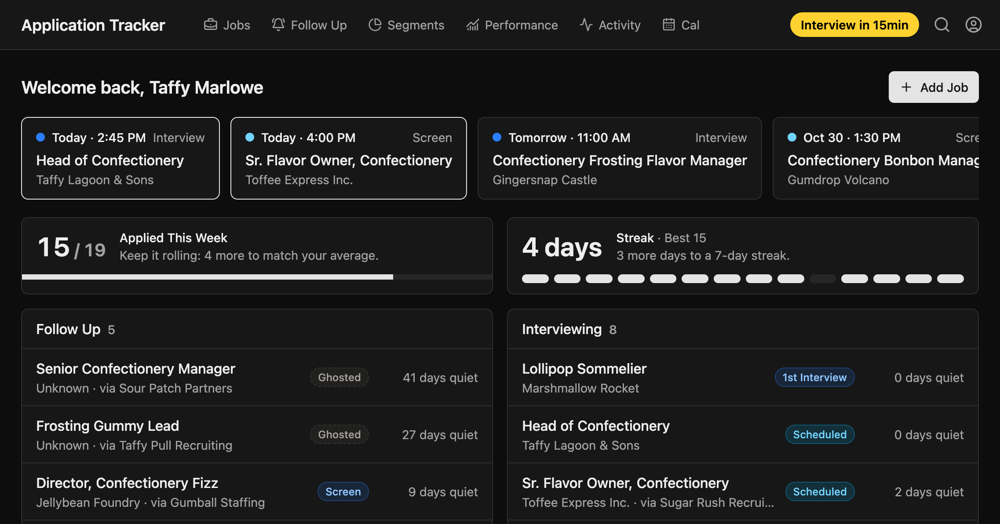
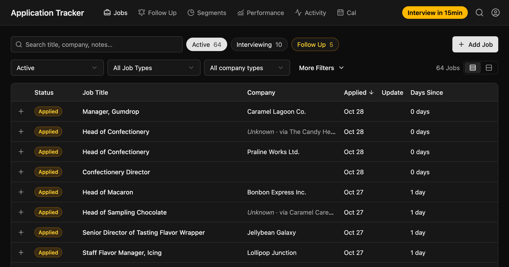
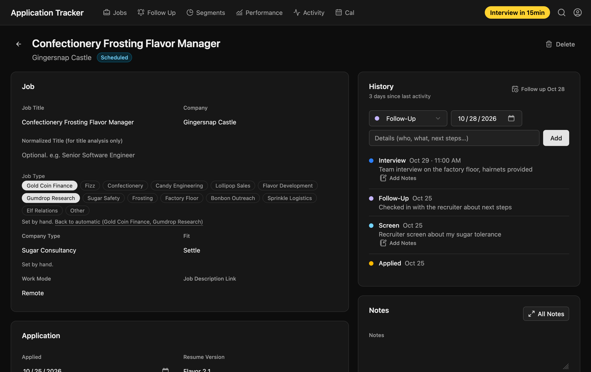
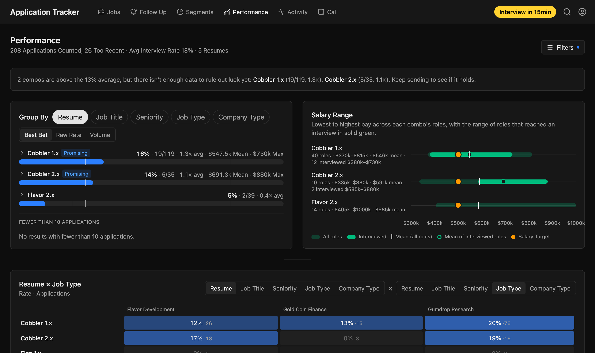
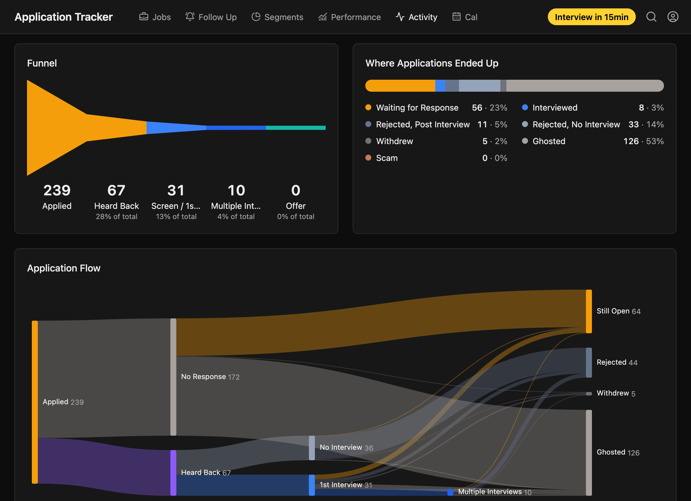
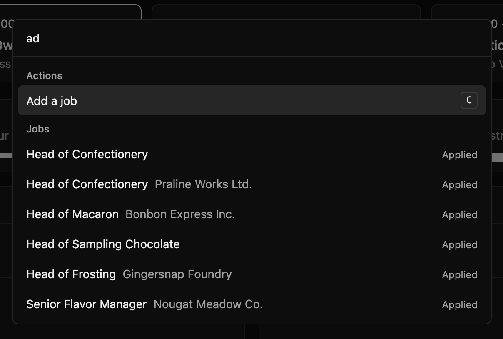

# Application Tracker

**A simple Job Application tracker that remembers the whole story of every application, then shows you what's working.**

Track applications. Analyze application performance. Keep up with roles to follow up with.

Local-only. Private. No third-party accounts. Free and open source.

## 👉 [**TRY THE LIVE DEMO**](https://brianpurkiss.github.io/Simple-Application-Tracker) 👈



## What it does

### 1. Streamlined application tracking and history

Log every event, keep organized notes, and get automatically reminded about roles to follow up on to keep the momentum.

[**Try it: Jobs list →**](https://brianpurkiss.github.io/Simple-Application-Tracker/jobs)



- **A full timeline for every job**: Applied, Contact, Follow-Up, Screen, Interview, Offer, Accepted, Rejection, Withdrew, and Ghosted
- **Log each interview's notes** with each application to remember the good (and the bad) about each role.
- **Automatic status organization** from the history, so you log what happened instead of editing a status field.
- **A sortable, searchable jobs** list with filters with compact and expanded views to find and compare.

[**Look at a job listing →**](https://brianpurkiss.github.io/Simple-Application-Tracker/jobs/231)



### 2. Analyze what's working, then iterate

Is the new resume version opening doors? Can I flex into a VP role? Do I get interviews when applying into a certain job type? Now I can analyze performance and (hopefully) figure it out. 

[**Try the analysis: Performance →**](https://brianpurkiss.github.io/Simple-Application-Tracker/performance)



- **Compare interview rates** and salary ranges across resumes, job titles, seniority, job type and company type, alone or combined in a heatmap. 
- **Graded application segments** against overall baseline with confidence tiers (Standout, Promising, Room to Grow, Low Volume). Small samples are dimmed to suppress the noise.
- **Jobs get automatically organized** into five different segments to analyze the different combinations. 

### 3. Keep the motivation going

The job hunt process is hard, and the longer it drags on, the more depressing it can be. A lack of understanding of effort or progress makes things harder. This doesn’t fix all the woes of the job hunt, but it does add some things to at least try and create some momentum.

- Application streaks, a weekly pace, and this week against trailing averages.
- A dashboard with upcoming interviews, follow-ups, and your last eight weeks.

### 4. Analytics, because data is fun

No, that’s not sarcasm. Data can be fun and interesting. … to me at least. 

[**Look at the fun data: Activity →**](https://brianpurkiss.github.io/Simple-Application-Tracker/activity) ·



- Activity shows the funnel from applied to offer, outcomes, response timing, weekly cohorts, weekday insights, and a salary distribution against your target.
- Bonus stats show a variety of interesting and fun data points. The data is there, why not plot it on a chart! Data is fun.
- Analytics have filters tied to the segments to identify any trends in what is available or what has momentum.
- A Calendar of everything that has happened and everything that's coming up.

## What you can do with it

- **Enter jobs fast.** Press `C`, add the basics, and automatic category matching suggests the Job Type and Company Type. It learns from your own past labels to build momentum and streamline the logging of applications. 
- **Keep roles from falling through the cracks.** Interviewing jobs with no activity for 7 days turn amber. Jobs that have gone quiet for 21 days show as Ghosted. Set a "Follow Up On" date to park a job until they said they'd be back. Scheduled interviews get a countdown on Home.
- **Interview better.** Keep per-interview notes on each history entry, notes on the job, the job description, contact details, plus a resume vault and a generic cover letter ready to go.
- **See the pattern.** Combine resume, job type and company type to see which combinations get interviews, and see how those roles land on salary against your target.

## Keyboard Shortcuts & Quick Actions

Keyboard-first, a command palette for everything else. Press `?` in the app for the full list of shortcuts and commands.

[**Try it: Keyboard shortcuts →**](https://brianpurkiss.github.io/Simple-Application-Tracker/shortcuts) - or press `Cmd+K` anywhere in the demo



## Why I built it

I tracked my job hunt in spreadsheets. They were slow to use, and despite being huge, the data tracking had limits. A spreadsheet row holds a snapshot: a status and maybe a date. It doesn’t provide a full history, notes get limiting, and… the whole thing just gets messy. 

I had been toying with the idea of building this most of my job hunt, telling myself it wasn’t worth it because I’d get a job any day now. And… time stretched on. 

So I built this to make it easier for me to get a good new job. 

It turned out to do more than I planned. I enjoy using it. I get real satisfaction out of logging progress, and I feel motivated to keep digging for more roles to apply to. I'm also less nervous about applying to stretch and pivot roles, because I can track and analyze those pivots. That lets me strategically flex into new areas instead of guessing. 

And besides. Charts and graphs are fun. 

## Get started

Want to look around first? [Try the demo](https://brianpurkiss.github.io/Simple-Application-Tracker).

To run your own private copy, you'll need [Node.js](https://nodejs.org/).

```bash
git clone https://github.com/brianpurkiss/Simple-Application-Tracker.git
cd Simple-Application-Tracker
npm install
npm run dev
```

Open the app in a browser. No login needed, all data stays local. 

## Under the hood

Built on open source and thrown together with AI. It may be messy under the hood, but it works quite well as a one off, short-term-use app. 

React 19, Vite, Tailwind, TanStack Query and Table, Recharts, Express 5, SQLite (better-sqlite3) and TypeScript.

## License

Released under the [MIT License](LICENSE.md).
